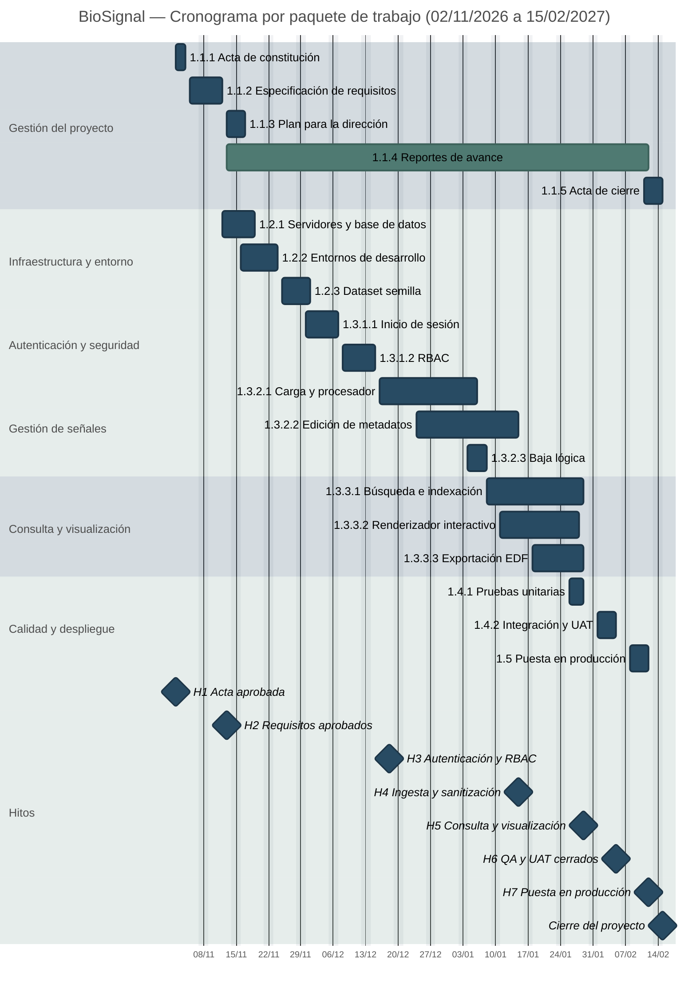

# Diagrama de Gantt — BioSignal

> **Fuente:** [[05-estructura-de-desglose-detrabajo|EDT (05)]], [[06-diccionario-del-edt|Diccionario del EDT (06)]] y [[02-acta-de-constitucion#10. Cronograma de Hitos de Aceptación|hitos del Acta (02)]]. Este documento ordena en el tiempo los paquetes de trabajo y sus hitos para el seguimiento del cronograma; **no reemplaza** al Diccionario, donde vive el detalle por actividad.

## 1. Criterios del cronograma

- **Calendario:** lunes a viernes; se excluyen fines de semana. Los feriados no se modelan en el diagrama.
- **Duración:** se usa el **tiempo estimado PERT** de cada actividad, convertido a días hábiles como `techo(horas / 8)`. La reserva por riesgo (prevención y contingencia) se controla por separado y no engrosa las barras.
- **Paralelismo:** el equipo tiene 6 integrantes; actividades de distintas ramas pueden ejecutarse en paralelo. Las dependencias se respetan a nivel de paquete y de contrato de interfaz.
- **Hitos:** las fechas de H1 a H7 y del cierre se toman del Acta y no se desplazan.
- **Nivel de detalle:** el diagrama muestra los **19 paquetes** y los hitos; las 66 actividades, su estimación PERT y sus dependencias se consultan en el Diccionario. Duplicar las 66 barras acá vuelve ilegible el gráfico en el ancho de lectura del sitio.
- **Pantallas anchas:** en pantallas ultrawide este documento amplía la página para aprovechar el ancho; si el diagrama queda chico, el botón de expandir del bloque Mermaid lo abre a pantalla completa con zoom y desplazamiento.

### 1.1. Fases de referencia

| Fase                                  | Ventana                 | Paquetes principales              |
| :------------------------------------ | :---------------------- | :-------------------------------- |
| 1. Iniciación y requisitos            | 02/11 – 01/12/2026      | 1.1.1, 1.1.2, 1.2.1, 1.2.2, 1.2.3 |
| 2. Seguridad y acceso                 | 30/11 – 18/12/2026      | 1.3.1.1, 1.3.1.2                  |
| 3. Backend, ingesta y gestión         | 16/12/2026 – 15/01/2027 | 1.3.2.1, 1.3.2.2, 1.3.2.3         |
| 4. Frontend, consulta y visualización | 08/01 – 29/01/2027      | 1.3.3.1, 1.3.3.2, 1.3.3.3         |
| 5. QA y despliegue                    | 26/01 – 12/02/2027      | 1.4.1, 1.4.2, 1.5                 |
| 6. Homologación y cierre              | 11/02 – 15/02/2027      | 1.1.5                             |

> Las fases 3 y 4 se solapan deliberadamente: el backend de ingesta se estabiliza mientras comienza la construcción del buscador y del visor. Las fases 4 y 5 también se solapan para llegar a H5 y H6 sin comprimir la UAT.

## 2. Gantt ejecutivo por paquete

Vista de alto nivel: una barra por paquete, con las fechas reales de su primera y última actividad, y los hitos del Acta. Es la vista recomendada para reportes de avance y para conversar el cronograma con el sponsor.

> `1.1.4` es recurrente (quincenal) y se dibuja como barra continua: no implica dedicación exclusiva. Los solapamientos entre paquetes son deliberados y corresponden a las fases 3–4 y 4–5.

### 2.1. Lectura del diagrama

- El diagrama es **ejecutivo**: muestra los 19 paquetes y los hitos, no las 66 actividades. Las actividades, su estimación PERT y sus dependencias se consultan en el [[06-diccionario-del-edt|Diccionario del EDT (06)]], que es la fuente de detalle.
- Un Gantt con 66 barras dentro del ancho de lectura del sitio vuelve ilegibles las etiquetas; por eso el detalle por actividad no se duplica acá.
- Los **hitos** se muestran con rombo y no consumen duración.
- La actividad **1.1.4 Reportes de avance** se representa como barra continua porque es recurrente cada dos semanas; no implica dedicación exclusiva.
- Las actividades de **1.3.3** se solapan sobre contratos de API ya acordados. El cierre funcional de la rama se valida contra **1.3.3.1.C** y **1.3.3.2.D**.
- La cadena crítica no se colorea en el diagrama para no saturar la vista; se detalla en la sección 3.

## 3. Ruta crítica

La cadena crítica planificada es la siguiente. Si una actividad de esta lista se retrasa, arrastra el hito correspondiente y la fecha de producción.

| Orden | Paquete / actividad                  | Inicio     | Fin        | Hito asociado |
| :---- | :----------------------------------- | :--------- | :--------- | :------------ |
| 1     | 1.1.1 Acta de constitución           | 02/11/2026 | 04/11/2026 | H1            |
| 2     | 1.1.2 Especificación de requisitos   | 05/11/2026 | 12/11/2026 | H2            |
| 3     | 1.2.1 Servidores y base de datos     | 12/11/2026 | 19/11/2026 | —             |
| 4     | 1.2.2 Entornos de desarrollo         | 16/11/2026 | 24/11/2026 | —             |
| 5     | 1.3.1.1 Interfaz de inicio de sesión | 30/11/2026 | 07/12/2026 | H3            |
| 6     | 1.3.1.2 RBAC                         | 08/12/2026 | 15/12/2026 | H3            |
| 7     | 1.3.2.1 Carga y procesador           | 16/12/2026 | 06/01/2027 | H4            |
| 8     | 1.3.2.2 Edición de metadatos         | 24/12/2026 | 15/01/2027 | H4            |
| 9     | 1.3.3.1 Búsqueda e indexación        | 08/01/2027 | 29/01/2027 | H5            |
| 10    | 1.3.3.2 Renderizador interactivo     | 11/01/2027 | 28/01/2027 | H5            |
| 11    | 1.3.3.3 Exportación de registros     | 18/01/2027 | 29/01/2027 | H5            |
| 12    | 1.4.1 Pruebas unitarias              | 26/01/2027 | 29/01/2027 | H6            |
| 13    | 1.4.2 Integración y aceptación       | 01/02/2027 | 05/02/2027 | H6            |
| 14    | 1.5 Despliegue en producción         | 08/02/2027 | 12/02/2027 | H7            |
| 15    | 1.1.5 Acta de cierre                 | 11/02/2027 | 15/02/2027 | H7 / Cierre   |

> **Holgura principal:** 1.2.3 Dataset semilla y 1.3.2.3 Baja lógica no están en la cadena crítica y tienen margen antes de H4. En cambio, 1.3.3.1, 1.3.3.2 y 1.3.3.3 convergen en H5 y no tienen holgura: un retraso en cualquiera de ellas mueve el hito.

## 4. Supuestos y limitaciones

1. **Equipo parcial:** se asume una dedicación compatible con 6 integrantes y una jornada de 8 h; si la dedicación real es menor, las barras deben estirarse o recortarse actividades.
2. **Dependencias de interfaz:** algunas actividades de 1.3.3 comienzan antes de que termine la actividad de backend de la que dependen funcionalmente, porque trabajan contra un contrato de API acordado. El cierre se valida al integrar.
3. **Feriados:** no se descuentan feriados nacionales o institucionales; un feriado dentro de una semana con holgura no altera los hitos.
4. **Reserva de riesgo:** la contingencia calculada en el Diccionario no se suma a las barras para no duplicar el seguimiento. Se controla como reserva del paquete.
5. **Cambios:** cualquier cambio de alcance, plazo o dependencia que mueva un hito requiere RFC y actualización del [[09-gestion-y-control-de-cambios|Change Log]] y de este diagrama.

## 5. Registro de cambios

| Versión | Fecha      | Cambio                                                                                                                                                               | Responsable | Estado   |
| :------ | :--------- | :------------------------------------------------------------------------------------------------------------------------------------------------------------------- | :---------- | :------- |
| v1.1    | 11/11/2026 | Gantt ejecutivo por paquete como vista única (sin duplicar el detalle por actividad del Diccionario), contraste de barras y etiquetas, y ancho ampliado en ultrawide | PM          | Aprobado |
| v1.0    | 11/11/2026 | Creación del Gantt detallado a partir del Diccionario del EDT v2.3                                                                                                   | PM          | Aprobado |
