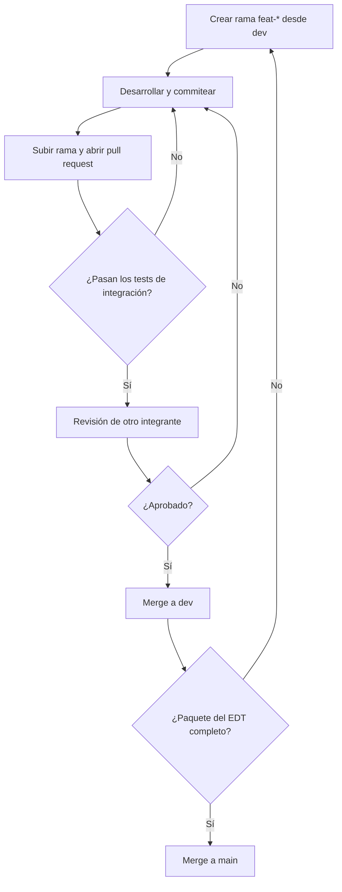

# Control de cambios del código

**Versión del documento:** 1.0  
**Fecha:** 16/10/2026  
**Responsable:** _(DevOps / PM)_

## 1. Objetivo

Definir cómo se registran, revisan, aprueban e integran los cambios en el código del repositorio, de modo que cada modificación sea trazable, esté verificada por pruebas automáticas y revisada por otro integrante antes de llegar a producción.

## 2. Alcance

Aplica a todo el código fuente del repositorio del proyecto (backend, frontend y scripts asociados) y a todos los integrantes que contribuyen a él.

## 3. Estructura de ramas

El repositorio es único y maneja dos ramas permanentes y ramas temporales por funcionalidad.

|                 |            |                                                                                   |                                                      |
| --------------- | ---------- | --------------------------------------------------------------------------------- | ---------------------------------------------------- |
| Rama            | Tipo       | Propósito                                                                         | Quién integra                                        |
| `main`          | Permanente | Código de producción. Siempre estable y desplegable.                              | Solo desde `test`, al completarse un paquete del EDT |
| test            | Permanente | Replica de producción                                                             |                                                      |
| `dev`           | Permanente | Código de desarrollo. Integra las funcionalidades aprobadas.                      | Desde ramas `feat-*` / `fix-*`, tras la revisión     |
| `feat-<nombre>` | Temporal   | Desarrollo de una funcionalidad. Ej: `feat-login` (función de login del backend). | Autor del cambio                                     |
| `fix-<nombre>`  | Temporal   | Corrección de un defecto.                                                         | Autor del cambio                                     |

**Reglas:**

- Nadie hace commits directos sobre `main` ni sobre `dev`.
- Las ramas temporales se crean a partir de `dev` y se eliminan una vez mergeadas.
- El nombre de la rama es corto, en minúsculas y con guiones.

## 4. Convención de commits

Cada commit lleva un prefijo que indica el tipo de cambio, seguido de una descripción breve en minúsculas.

```
<tipo>: <descripción>
```

|        |                        |                           |
| ------ | ---------------------- | ------------------------- |
| Tipo   | Uso                    | Ejemplo                   |
| `feat` | Nueva funcionalidad    | `feat: algo del login`    |
| `fix`  | Corrección de un error | `fix: username por email` |

Buenas prácticas:

- Un commit representa un cambio lógico y acotado.
- La descripción dice qué se hizo, no cómo.
- Si el cambio responde a una tarea del EDT, se menciona su código en el cuerpo del commit o del pull request.

## 5. Flujo de cambios

### 5.1 Desde la rama de funcionalidad hasta `dev`

1. **Crear la rama** `feat-<nombre>` a partir de `dev`.
2. **Desarrollar** haciendo commits con la convención del punto 4.
3. **Subir la rama** al repositorio remoto y abrir un pull request hacia `dev`.
4. **Tests de integración automáticos:** se ejecutan al subir la rama.
   - Si fallan, el autor corrige y vuelve a subir. El pull request no avanza.
   - Si pasan, continúa a la revisión.
5. **Revisión de código:** la realiza otro integrante del equipo, nunca el autor.
   - Si hay observaciones, el autor las resuelve y se repite desde el paso 4.
   - Si se aprueba, continúa al merge.
6. **Merge a `dev`** y eliminación de la rama temporal.

### 5.2 Desde `dev` hasta `main`

1. Se acumulan en `dev` las funcionalidades que componen un **paquete de trabajo del EDT**.
2. Cuando el paquete está completo y los tests pasan sobre `dev`, se hace el merge de `dev` a `main`.
3. Se registra la entrega en el historial de cambios (punto 8).

### 5.3 Diagrama del flujo



## 6. Criterios de aprobación

Un cambio se puede mergear a `dev` solo si cumple todo lo siguiente:

- Los tests de integración automáticos pasan.
- Fue revisado y aprobado por al menos un integrante distinto del autor.
- Los commits respetan la convención.
- No tiene conflictos con `dev`.

Un merge de `dev` a `main` requiere además que el paquete del EDT correspondiente esté completo.

## 7. Roles y responsabilidades

|                           |                                                                             |
| ------------------------- | --------------------------------------------------------------------------- |
| Rol                       | Responsabilidad en el control de cambios                                    |
| Programador (autor)       | Crea la rama, desarrolla, escribe commits claros, resuelve observaciones.   |
| Revisor (otro integrante) | Revisa el código, aprueba o solicita cambios.                               |
| QA                        | Mantiene los tests de integración y verifica que cubran el cambio.          |
| DevOps                    | Mantiene la ejecución automática de los tests y la protección de las ramas. |
| PM                        | Confirma que el paquete del EDT está completo antes del merge a `main`.     |

## 8. Registro de cambios

Cada merge a `main` se registra con el siguiente formato:

|              |         |                   |                         |             |
| ------------ | ------- | ----------------- | ----------------------- | ----------- |
| Fecha        | Versión | Paquete del EDT   | Cambios incluidos       | Responsable |
| _dd/mm/aaaa_ | _x.y.z_ | _código y nombre_ | `feat: ...`, `fix: ...` | _nombre_    |

## 9. Ejemplo completo

Cambio: función de login del backend.

1. Se crea la rama `feat-login` desde `dev`.
2. Commits:
   - `feat: algo del login`
   - `fix: username por email`
3. Se sube la rama y se abre el pull request hacia `dev`.
4. Pasan los tests de integración automáticos.
5. Otro integrante revisa y aprueba.
6. Se mergea `feat-login` a `dev`.
7. Cuando se completan las demás funcionalidades del paquete del EDT, se mergea `dev` a `main`.
